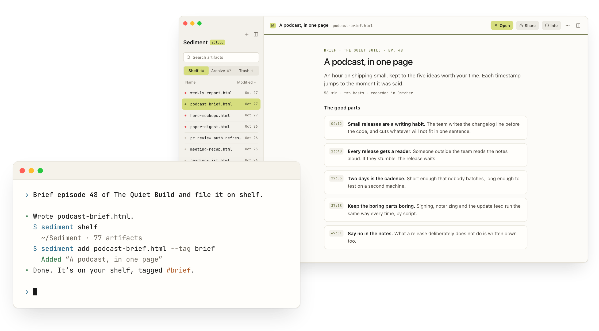

# Sediment

<picture>
  <source media="(prefers-color-scheme: dark)" srcset="assets/hero-dark.png">
  
</picture>

**Agents write. You read. Sediment is the shelf between.**

Your agent files each page with one command: a brief, a research report,
a dashboard, a plan. You read them all in one place, on your Mac.

- **Local-first.** The shelf is a folder on your disk, and the app is a view
  over it. No account, nothing tracked, and any folder sync works with it.
- **Keyboard-driven.** Every common action is a chord away, and the chords
  match the Mac you already know.
- **Agent-native.** Say "file it on shelf" in your own words. Your agent
  files, tags and revises pages for you.
- **Sandboxed.** A page someone shares with you runs in full, but it can't
  see your other pages, tell its sender you opened it, or send what you type.

More at [unfussy.software/sediment](https://unfussy.software/sediment).

## Install

Sediment is in beta and needs macOS 26.5 or later.

1. Download `Sediment-<version>.dmg` from the
   [latest release](https://github.com/unfussy-software/sediment-desktop-release/releases/latest).
   A `.zip` of the same app sits beside it.
2. Open it and drag Sediment into your Applications folder.
3. Launch Sediment and choose the folder your shelf will live in. Any folder
   works, including one that iCloud Drive, Dropbox or OneDrive syncs.

The app is signed and notarized, so it opens without a Gatekeeper override.
It checks for updates by itself; see what changed in the
[changelog](https://unfussy.software/sediment/changelog).

## Feedback

[Open an issue](https://github.com/unfussy-software/sediment-desktop-release/issues/new)
in this repository. Say which version you're on (Sediment → About Sediment)
and what you expected to happen.
